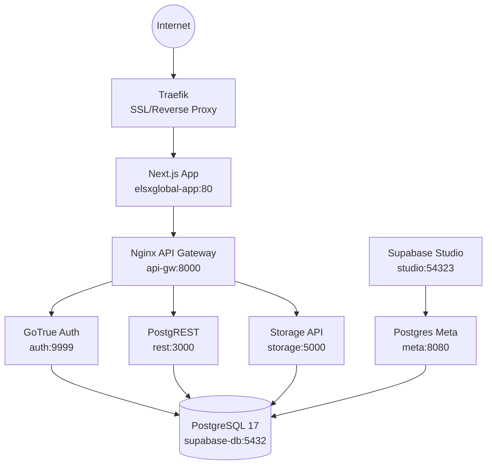

---
# =================================================================
# ELSxGlobal + VaultHost — Operations Manual
# =================================================================
# Single source of truth for running this system in production.
# Keep this document updated with every operational change.
# =================================================================

# 🚀 ELSxGlobal + VaultHost — Operations Manual

> **Stack**: Next.js 13 + Supabase (self-hosted) + PostgreSQL 17 + Nginx API Gateway  
> **Platform**: Coolify on Proxmox Ubuntu VM  
> **Domain**: https://www.elsxglobal.com

---

## ⚡ Quick Reference Card

| Task | Command |
|------|---------|
| Check all service status | `./scripts/manage.sh status` |
| View live logs | `./scripts/manage.sh logs [service]` |
| Health check | `./scripts/manage.sh health` |
| Backup database now | `./scripts/manage.sh backup` |
| Restore from backup | `./scripts/manage.sh restore` |
| Run DB migrations | `./scripts/manage.sh migrate` |
| Open DB console | `./scripts/manage.sh psql` |
| Shell into app | `./scripts/manage.sh shell` |
| Rotate secrets | `./scripts/manage.sh rotate-secrets` |
| Deploy latest code | `./scripts/manage.sh deploy` |
| Supabase Studio URL | `./scripts/manage.sh studio-url` |

---

## Architecture



### Services

| Container | Image | Port | Role |
|-----------|-------|------|------|
| `supabase-db` | `supabase/postgres:17.6.1.136` | 5432 | Primary database |
| `supabase-auth` | `supabase/gotrue:v2.197.0` | 9999 | JWT auth (GoTrue) |
| `supabase-rest` | `postgrest/postgrest:v14.18` | 3000 | Auto REST API |
| `supabase-storage` | `supabase/storage-api:v1.19.0` | 5000 | File storage |
| `supabase-meta` | `supabase/postgres-meta:v0.100.0` | 8080 | DB metadata API |
| `supabase-studio` | `supabase/studio:2026.11.02-...` | 54323 | Visual admin UI |
| `supabase-gateway` | `nginx:alpine` | 8000 | API gateway/proxy |
| `elsxglobal-app` | Custom built Next.js | 80 | Main application |

---

## Environment Variables Reference

| Variable | Description | Default | Required |
|----------|-------------|---------|----------|
| `POSTGRES_PASSWORD` | PostgreSQL master password | `postgres_standalone_pwd_2026` | ✅ |
| `JWT_SECRET` | Supabase JWT signing secret (32+ chars) | — | ✅ |
| `ANON_KEY` | Supabase anon JWT token | — | ✅ |
| `SERVICE_ROLE_KEY` | Supabase service role JWT (bypass RLS) | — | ✅ |
| `NEXT_PUBLIC_SUPABASE_URL` | Supabase API URL seen by browser | `http://api-gw:8000` | ✅ |
| `NEXT_PUBLIC_SUPABASE_ANON_KEY` | Anon key sent to browser | Same as `ANON_KEY` | ✅ |
| `SUPABASE_SERVICE_ROLE_KEY` | Server-side service role key | Same as `SERVICE_ROLE_KEY` | ✅ |
| `DATABASE_URL` | Direct Postgres connection for migrations | `postgresql://postgres:...@db:5432/postgres` | ✅ |
| `NEXT_PUBLIC_SITE_URL` | Public website URL | `https://www.elsxglobal.com` | ✅ |
| `NEXT_PUBLIC_RAZORPAY_KEY_ID` | Razorpay public key | — | For payments |
| `RAZORPAY_KEY_SECRET` | Razorpay secret key (server-side) | — | For payments |
| `RAZORPAY_WEBHOOK_SECRET` | Razorpay webhook signing secret | — | For webhooks |
| `BACKUP_S3_BUCKET` | S3 bucket for offsite backup | — | Optional |
| `BACKUP_KEEP_COUNT` | Number of local backups to retain | `30` | Optional |
| `STUDIO_PORT` | Supabase Studio exposed port | `54323` | Optional |

> [!IMPORTANT]
> Never commit `.env` to git. It contains your master database password and JWT secret.
> Store a copy in a password manager (Bitwarden, 1Password) or encrypted vault.

---

## Backup & Recovery

### Automatic Backups

Nightly backups run at **2:00 AM UTC** via cron. Install with:
```bash
bash scripts/cron-setup.sh
```

Backups are stored at `/opt/elsxglobal/backups/` as:
- `YYYY-MM-DD_HH-MM-SS_nightly.dump` — PostgreSQL custom format (compressed)
- `YYYY-MM-DD_HH-MM-SS_nightly.json` — Manifest with checksum, size, pg version

### Manual Backup

```bash
./scripts/manage.sh backup                    # Named 'manual'
./scripts/manage.sh backup --name pre-upgrade # Named backup
```

### Restore from Backup

```bash
# Interactive (shows picker)
./scripts/manage.sh restore

# Direct file
./scripts/manage.sh restore /opt/elsxglobal/backups/2026-11-21_02-00-00_nightly.dump
```

> [!CAUTION]
> Restore is **destructive** — all current data will be replaced. The script creates a pre-restore safety backup automatically.

### Restore Single Table (Partial Recovery)

```bash
# Extract a single table from a backup
docker exec supabase-db pg_restore -U postgres -d postgres \
  --table=hosting_orders /path/to/backup.dump
```

### Offsite / S3 Backup

Add to `.env`:
```
BACKUP_S3_BUCKET=s3://your-bucket/elsxglobal-backups
AWS_ACCESS_KEY_ID=your_key
AWS_SECRET_ACCESS_KEY=your_secret
AWS_DEFAULT_REGION=ap-south-1
```

Backups will automatically upload to S3 after each local backup.

---

## Deployment

### Standard Code Deployment (Zero-Downtime)

```bash
# Option 1: via manage.sh (recommended)
./scripts/manage.sh deploy

# Option 2: via Makefile
make deploy

# Option 3: manual
git pull origin main
docker compose pull --ignore-buildable
docker compose up -d --build
```

### Pre-Deployment Checklist

- [ ] Run `npx tsc --noEmit` — no TypeScript errors
- [ ] Run `npm run lint` — no lint errors
- [ ] All new migrations added to `supabase/migrations/`
- [ ] `.env.example` updated if new env vars added
- [ ] `CHANGELOG.md` updated

### Rollback Procedure

```bash
# Option 1: Rollback via git (code only, no DB change)
git revert HEAD
git push origin main
# Then redeploy in Coolify

# Option 2: Full rollback with DB restore
./scripts/manage.sh restore /opt/elsxglobal/backups/LAST-KNOWN-GOOD.dump
# Then checkout old code version in Coolify
```

---

## Database Operations

### Open PostgreSQL Console

```bash
./scripts/manage.sh psql
# or:
make psql
```

### Run SQL One-liner

```bash
./scripts/manage.sh psql "SELECT count(*) FROM hosting_orders WHERE status='active';"
```

### Check Migration Status

```bash
./scripts/manage.sh psql "SELECT * FROM schema_migrations ORDER BY version;"
```

### Manual Migration Run

```bash
./scripts/manage.sh migrate
```

### Database Inspection

```bash
# Table counts
./scripts/manage.sh psql "SELECT schemaname, tablename, pg_size_pretty(pg_total_relation_size(schemaname||'.'||tablename)) FROM pg_tables WHERE schemaname='public' ORDER BY pg_total_relation_size(schemaname||'.'||tablename) DESC;"

# Active connections
./scripts/manage.sh psql "SELECT * FROM pg_stat_activity WHERE state = 'active';"

# DB size
./scripts/manage.sh psql "SELECT pg_size_pretty(pg_database_size('postgres'));"
```

---

## Monitoring

### Health Check

```bash
./scripts/manage.sh health
```

Checks: container status, app `/api/health`, disk usage, memory, backup age.

### View Logs

```bash
./scripts/manage.sh logs           # All services
./scripts/manage.sh logs app       # App only
./scripts/manage.sh logs db        # Database only
./scripts/manage.sh logs auth      # GoTrue auth
```

### Live Resource Monitor

```bash
./scripts/manage.sh top
# or:
make top
```

### Automated Health Monitoring

The cron job runs `./scripts/health-monitor.sh --quiet` every 5 minutes.
Logs: `/var/log/elsxglobal/health.log`

---

## Security

### Secret Rotation (Quarterly Recommended)

```bash
./scripts/manage.sh rotate-secrets
```

This:
1. Generates new `POSTGRES_PASSWORD` and `JWT_SECRET` via `openssl rand`
2. Updates PostgreSQL user password live
3. Updates `.env` file
4. Restarts auth and rest services
5. Prints instructions for updating Coolify env vars

> [!WARNING]
> After rotation, you MUST update `POSTGRES_PASSWORD` and `JWT_SECRET` in Coolify → Environment Variables, then redeploy. Failing to do so will cause the next deployment to use old credentials.

### Access Control

- **Supabase Studio** (`port 54323`): Restrict via firewall to your IP only
  ```bash
  ufw allow from YOUR_IP to any port 54323
  ufw deny 54323
  ```
- **PostgreSQL** (`port 5432`): Only expose locally (don't expose publicly unless needed)
- **API Gateway** (`port 8000`): Internal only in production (Traefik handles public routing)

### Audit Log

Every `manage.sh` command is logged to `/var/log/elsxglobal/audit.log`:
```
[2026-11-21 10:00:00 UTC] USER=root CMD=backup ARGS=pre-upgrade
[2026-11-21 10:05:00 UTC] USER=deploy CMD=deploy ARGS=
```

---

## Troubleshooting

### DB Container Won't Start

```bash
./scripts/manage.sh logs db
```

Common causes:
- **Volume permission error**: `chown -R 999:999 $(docker volume inspect elsxglobal_db_data --format '{{ .Mountpoint }}')`
- **Port conflict**: `lsof -i :5432` — another PostgreSQL instance is running

### `auth.jwt() does not exist`

Means migrations ran before the auth schema stubs. The file `00000000000000_supabase_auth_stubs.sql` should fix this. If it's already in `supabase/migrations/`, the fix is applied.

If still happening, run manually:
```bash
./scripts/manage.sh psql < supabase/migrations/00000000000000_supabase_auth_stubs.sql
```

### App Can't Connect to Database

Check `DATABASE_URL` env var — must be `postgresql://postgres:PASSWORD@db:5432/postgres` (not `127.0.0.1`).

```bash
./scripts/manage.sh psql "SELECT 1;"  # Verify DB is reachable
./scripts/manage.sh logs app | grep "database"
```

### GoTrue / Auth Fails to Start

```bash
./scripts/manage.sh logs auth
```

Common: `GOTRUE_DB_DATABASE_URL` uses wrong password. Ensure it matches `POSTGRES_PASSWORD`.

Also check: `supabase_auth_admin` role exists in DB:
```bash
./scripts/manage.sh psql "\du supabase_auth_admin"
```

### Nginx Gateway Returns 502

```bash
./scripts/manage.sh logs api-gw
```

Means auth or rest container isn't healthy. Check their logs and health:
```bash
./scripts/manage.sh logs auth
./scripts/manage.sh logs rest
```

### Out of Disk Space

```bash
df -h
./scripts/manage.sh cleanup          # Remove unused Docker images
./scripts/manage.sh backup           # Then delete old backups manually if needed
ls -lh /opt/elsxglobal/backups/      # Check backup dir size
```

---

## First-Time Setup on a New Server

```bash
# 1. Clone the repo
git clone https://github.com/shashankoppo/elsxglobal_website /opt/elsxglobal/app
cd /opt/elsxglobal/app

# 2. Run setup wizard (auto-generates credentials, pulls images, starts services)
bash scripts/setup-wizard.sh

# 3. Verify health
./scripts/manage.sh health

# 4. Install cron jobs for automated backups
bash scripts/cron-setup.sh
```

---

## Support

- Logs: `/var/log/elsxglobal/`
- Backups: `/opt/elsxglobal/backups/`
- Audit log: `/var/log/elsxglobal/audit.log`
- GitHub: https://github.com/shashankoppo/elsxglobal_website
- Contact: contact@elsxglobal.com
